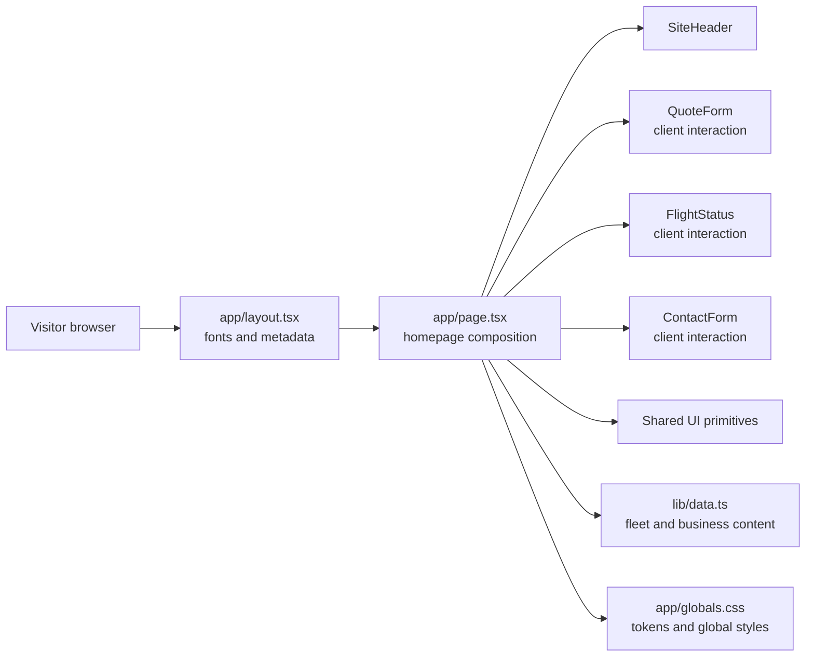
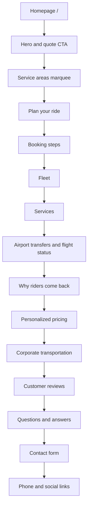
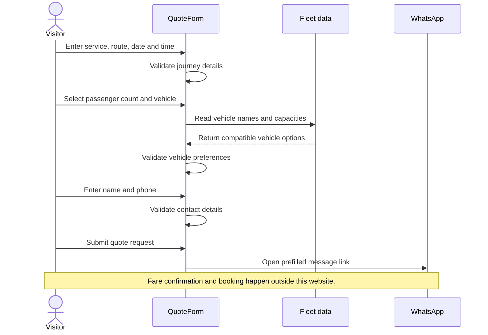

# Sherwan Limo

Sherwan Limo is a responsive website for a private chauffeur and luxury ground-transportation company serving Toronto and the Greater Toronto Area (GTA). The site presents the fleet and services, answers common questions, and guides visitors through a quote request.

## Contents

- [Highlights](#highlights)
- [Technology](#technology)
- [Run locally](#run-locally)
- [Project structure](#project-structure)
- [Architecture](#architecture)
- [Site map](#site-map)
- [Quote-request flow](#quote-request-flow)
- [Business content reference](#business-content-reference)
- [Integrations and current limitations](#integrations-and-current-limitations)

## Highlights

- Responsive, single-page company website with fleet, services, airport transfers, corporate transportation, pricing information, reviews, FAQ, and contact sections.
- Guided three-step quote request: journey, vehicle, and contact details.
- Vehicle options are drawn from the fleet content and filtered against the selected passenger count.
- Quote requests are handed off to WhatsApp with the entered trip details; the site does not confirm or charge for a booking.
- Contact messages are composed in the visitor's email application.
- Flight-status searches open Google results for the submitted flight number.
- Reduced-motion styling is provided for motion-sensitive visitors.

## Technology

- Next.js 15 with the App Router
- React 19 and TypeScript
- Tailwind CSS 4
- Radix UI Accordion, Radix Slot, and class-variance-authority
- Lucide icons
- Google Fonts loaded through `next/font/google` (Fraunces and Manrope)

## Run locally

Use a compatible Node.js installation and npm.

```bash
npm install
npm run dev
```

Open the local URL printed by Next.js. The default development port is `3000`; if it is already occupied, Next.js chooses another available port.

Available project scripts:

| Command | Purpose |
| --- | --- |
| `npm run dev` | Start the development server. |
| `npm run build` | Create a production build. |
| `npm run start` | Serve the most recent production build. Run `npm run build` first. |

There is no lint script or automated test suite defined in `package.json`. TypeScript can be checked directly with:

```bash
npx tsc --noEmit
```

No environment variables are currently required by the application.

## Project structure

```text
app/
  globals.css       Theme tokens, Tailwind theme, global styles, motion rules
  layout.tsx        Root layout, fonts, document metadata
  page.tsx          Homepage sections and shared page composition
components/
  site-header.tsx   Main navigation and primary quote action
  quote-form.tsx    Three-step quote request and WhatsApp handoff
  contact-form.tsx  Contact form and email-client handoff
  flight-status.tsx Flight-number search handoff
  ui/               Shared Button, Card, Input, Accordion primitives
lib/
  data.ts           Fleet, services, FAQs, reviews, areas, and contact constants
  utils.ts          Shared class-name utility
```

## Architecture

The homepage composes server-rendered page content with small client components for interactions. Reusable business content lives in `lib/data.ts`; visual tokens and global behavior live in `app/globals.css`.



## Site map

The site is a single homepage. Navigation links and calls to action scroll to section IDs rather than opening separate application routes.



## Quote-request flow

The browser validates each stage before advancing. On submission, the completed request is encoded into a WhatsApp link; it is not stored by a Sherwan Limo application server.



## Business content reference

The following information reflects the site's current static content. Update `lib/data.ts` when fleet details, service claims, FAQs, reviews, coverage, or contact details change.

### Contact and coverage

- Phone: `437-237-2311`
- Email: `sherwanlimo@gmail.com`
- Coverage named on the site: Toronto, Mississauga, and the GTA
- Listed service areas: Toronto, Mississauga, Brampton, Oakville, Vaughan, Markham, Milton, Burlington, Hamilton, Etobicoke, Scarborough, Richmond Hill, Pickering, Ajax, Whitby, Oshawa, Newmarket, Barrie, Niagara Falls, Kitchener, Waterloo, Cambridge, London, and Muskoka
- Availability stated on the site: 24 hours a day, 7 days a week

### Fleet

Passenger and luggage capacities below are the values currently stored in `lib/data.ts`.

| Vehicle | Site label | Passengers | Bags |
| --- | --- | ---: | ---: |
| Mercedes-Benz Sprinter Limo Van | Luxury Van | 14 | 10 |
| Cadillac Escalade ESV Platinum | Executive choice | 6 | 5 |
| GMC Yukon XL Denali Ultimate | Premium class | 6 | 5 |
| Lincoln Navigator Black Label L | Luxury choice | 7 | 5 |
| Mercedes-Benz S-Class S500 | Executive sedan | 3 | 3 |
| Luxury Party Bus Executive Coach | Party bus | 30 | 2 |

### Services and policies represented in site copy

- Airport transfers, including flight tracking, meet-and-greet, and 30 minutes of complimentary airport wait time.
- Executive chauffeur service and corporate transportation.
- Weddings, events, and group transportation.
- Fares are described as personalized, fixed, and without surge pricing. Exact prices are requested rather than calculated or published on the site.
- Corporate-account copy references priority booking, monthly billing, itemized trip reports, and a dedicated point of contact.
- The quote is a request only. The customer approves the fare before confirming; no online payment is collected by this website.

### Quote form fields

The request captures service type, pickup and drop-off locations, date, time, passenger count, preferred vehicle, name, and phone number. Service types are point-to-point, airport transfer, hourly chauffeur, and events/weddings. Vehicle capacity options are derived from the fleet list; visitors can also ask Sherwan Limo to recommend a vehicle.

## Integrations and current limitations

- **WhatsApp:** `QuoteForm` opens `wa.me` with a prefilled message containing trip and contact details. It does not send the message automatically; the visitor completes the handoff in WhatsApp.
- **Email:** `ContactForm` opens the visitor's default email application with a prefilled message to `sherwanlimo@gmail.com`. The website does not submit contact messages to a backend.
- **Flight status:** `FlightStatus` opens a Google search for the entered flight number. It is not connected to a live flight-data provider.
- **Images:** Fleet and editorial images are served from `media.base44.com`; the host is allowed in `next.config.mjs` for Next.js image optimization.
- **Persistence and payments:** There is no application API, database, account system, online payment, or booking confirmation flow in the current project.

Quote requests include personal contact and trip details in a URL handed to WhatsApp. Keep the user informed about that external handoff and avoid collecting information that is not needed to respond to the request.